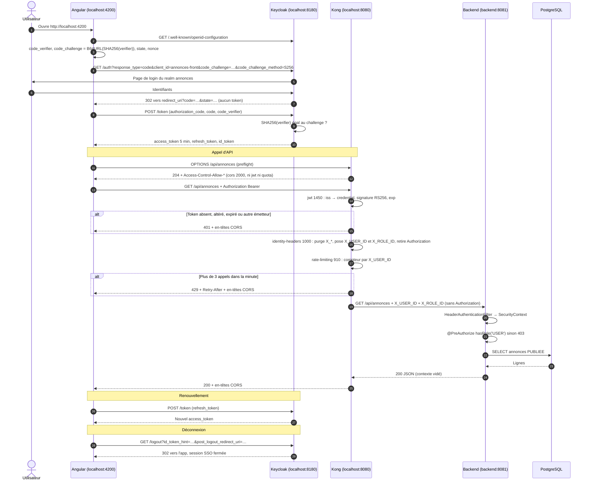

# 00 — Compréhension du projet PetitesAnnonces

> Document de référence : il explique **ce qu'on construit** et **pourquoi chaque brique existe**.
> Le cahier des charges complet est dans [`PROMPT.md`](PROMPT.md).

## 1. Reformulation

PetitesAnnonces est une application de gestion d'annonces dont le fonctionnel est volontairement
minimal (annonces, modération, catégories). L'enjeu est **l'architecture de sécurité** : suivre un
jeton émis par Keycloak à travers 5 conteneurs, en respectant un principe simple — **une
responsabilité par composant**.

| Composant | Responsabilité | Ce qu'il ne fait **pas** |
|---|---|---|
| **Keycloak** (`localhost:8180`) | **Authentifie** : login, session SSO, émission des tokens signés RS256 (access 5 min, refresh, id), rôles composites | Ne voit jamais les appels d'API |
| **Kong OSS** DB-less (`localhost:8080`) | **Contrôle** : CORS, validation du JWT (signature, `iss`, `exp`), traduction du token en headers d'identité, quota 3 appels/min/utilisateur | Aucune règle métier ; n'appelle jamais Keycloak (clé publique figée dans `kong.yml`) |
| **Backend** Spring Boot 3 (`backend:8081`, non exposé) | **Autorise** : reconstruit un `Authentication` depuis `X_USER_ID`/`X_ROLE_ID`, `@PreAuthorize` sur chaque règle | Ne lit aucun JWT, aucune dépendance OAuth2, n'appelle jamais Keycloak |
| **Angular** servi par Nginx (`localhost:4200`) | Flux Authorization Code + PKCE, stockage des tokens (sessionStorage), Bearer vers la gateway, refresh, logout | Le masquage des menus est un confort, jamais une sécurité |
| **PostgreSQL 16** (non exposé) | Bases `keycloak` et `annonces`, volume nommé, schéma via Flyway | — |

Réseau : seuls 4200, 8080 et 8180 sont publiés. `backend` et `postgres` ne vivent que sur le réseau
`internal`. **Le token s'arrête à Kong** : en aval, l'identité ne circule qu'en headers.

## 2. Flux complet, pas à pas

### 2.1 Connexion — Authorization Code + PKCE

1. L'utilisateur ouvre `http://localhost:4200`. Angular charge `config.json` (URLs injectées au
   démarrage du conteneur), récupère le document de découverte OIDC du realm et constate qu'il n'a
   pas de token valide.
2. Angular génère un `code_verifier` aléatoire, calcule
   `code_challenge = BASE64URL(SHA256(code_verifier))` via la Web Crypto API, plus un `state`
   (anti-CSRF) et un `nonce` (anti-rejeu de l'id_token). Il les garde en `sessionStorage`.
3. Redirection vers `/realms/annonces/protocol/openid-connect/auth` avec `response_type=code`,
   `client_id=annonces-front`, `redirect_uri`, `scope=openid …`, `state`, `nonce`,
   `code_challenge`, `code_challenge_method=S256`. Keycloak vérifie la `redirect_uri` et exige PKCE.
4. L'utilisateur s'authentifie. Keycloak crée une session SSO (cookie sur `localhost:8180`) et un
   **code à usage unique**, lié au challenge.
5. Retour `302 redirect_uri?code=…&state=…` — **aucun token dans l'URL**. Angular vérifie `state`.
6. Angular envoie `POST /token` (`grant_type=authorization_code`, `code`, `code_verifier`), en
   cross-origin : Keycloak répond avec CORS car `webOrigins` contient l'URL du front. Keycloak
   recalcule le hash du verifier, le compare au challenge et renvoie `access_token`,
   `refresh_token`, `id_token`.

**Pourquoi PKCE ?** Une SPA est un *client public* : son code est lisible, elle ne peut garder aucun
secret. Si le code d'autorisation est intercepté (historique, logs, extension), il est inutilisable
sans le `code_verifier` qui n'a jamais quitté le navigateur. Le flux *implicit* (token dans l'URL)
et le grant *password* (l'appli manipule le mot de passe) sont désactivés.

### 2.2 Appel d'API

7. L'`HttpInterceptor` ajoute `Authorization: Bearer <access_token>` **uniquement** vers la gateway.
8. **Preflight CORS** : la requête est cross-origin et porte `Authorization` → le navigateur envoie
   d'abord `OPTIONS`. Le plugin `cors` (priorité 2000) y répond seul : ni `jwt`, ni `rate-limiting`
   ne s'exécutent. Une origine inconnue ne reçoit pas d'`Access-Control-Allow-Origin`.
9. **`jwt`** (1450) : lit `iss` (non vérifié), cherche le credential dont la `key` vaut exactement
   `iss`, vérifie la signature RS256 avec la clé publique PEM, puis `exp`. Échec → **401**, backend
   jamais appelé.
10. **`identity-headers`** (1000, plugin Lua maison) : purge `X_USER_ID`/`X_ROLE_ID` venant du client,
    relit le token déjà validé, pose `X_USER_ID = sub` et `X_ROLE_ID = MODERATEUR,USER` (filtré),
    supprime `Authorization`. Sa priorité est < 1450 (le token est déjà validé) et > 910 (le
    rate limiting voit le bon header).
11. **`rate-limiting`** (910) : compteur par valeur de `X_USER_ID`, fenêtre fixe d'une minute ;
    4ᵉ appel → **429** + `Retry-After`, backend non appelé.
12. Kong relaie vers `http://backend:8081/api/…` sur le réseau interne.
13. **`HeaderAuthenticationFilter`** construit un `Authentication` (principal = `sub`, autorités
    `ROLE_…`) dans le `SecurityContextHolder`. Pas de `X_USER_ID` → contexte vide →
    `AuthenticationEntryPoint` → **401** ProblemDetail.
14. **`@PreAuthorize`** autorise ou renvoie **403** ProblemDetail ; le service interroge PostgreSQL.
    Le contexte est vidé en fin de requête, aucune session n'est créée.
15. La réponse revient par Kong qui ajoute les en-têtes CORS — y compris sur 401/403/429, sinon le
    front ne pourrait lire ni le statut ni `Retry-After`.

### 2.3 Cycle de vie

16. **Refresh** : vers 75 % de la durée de vie, `POST /token` (`grant_type=refresh_token`), sans
    écran de login. Borné par la session SSO de Keycloak.
17. **Déconnexion** : `end_session_endpoint` avec `id_token_hint` + `post_logout_redirect_uri` ;
    la session SSO est fermée, le stockage purgé, un retour sur l'app redemande le login.
18. **Erreurs front** : 401 → login (après une tentative de refresh) ; 403 → « accès refusé » sans
    déconnexion ; 429 → message avec le délai lu dans `Retry-After` (exposé par CORS).

### 2.4 Diagramme de séquence

### 2.5 Cas d'attaque

| Attaque | Qui bloque | Résultat |
|---|---|---|
| Token absent, signature altérée, expiré, autre realm | plugin `jwt` | 401, backend non appelé |
| `X_USER_ID` forgé | `identity-headers` (et Nginx ignore déjà les headers avec `_`) | écrasé par le `sub` du token |
| `X-User-Id` (tirets) pour fausser la clé du rate limiting | `identity-headers` purge aussi cette variante | quota respecté |
| `X_ROLE_ID: ADMIN` forgé | `identity-headers` | ignoré → 403 sur une action ADMIN |
| Token en query string `?jwt=` | `jwt` avec `uri_param_names: []` | refusé (le token n'atteint jamais le backend) |
| Appel direct au backend | réseau | impossible, port non publié |

## 3. Déploiement

1. **CI** (push / PR) : tests backend (Testcontainers), lint/tests/build front, validation de
   `kong.yml` + `luacheck`, `docker compose config`, e2e gateway sur une stack complète.
2. **CD** (`main` / tags `v*`, après CI verte) : build multi-stage, push sur Docker Hub
   (tags SHA court + `latest`), copie des fichiers montés sur la VM, `.env` depuis un secret GitHub,
   `docker compose pull` puis `up -d --no-build`, smoke tests, nettoyage.
3. **Rollback** : redéployer avec un `IMAGE_TAG` précédent.

## 4. Pièges identifiés

**Kong**
- `uri_param_names` vaut `["jwt"]` par défaut : on le vide, sinon un token passé en URL atteindrait
  le backend.
- Nginx confond `-` et `_` dans `$http_x_user_id` : un client pourrait fausser la clé du rate
  limiting avec `X-User-Id`. Le plugin purge les deux variantes ; un test le prouve.
- Le plugin `jwt` ne lit pas le JWKS → **paire RSA fixe** dans le realm.
- `key` du credential = `iss` **au caractère près** (schéma, port, pas de slash final).
- Le rate limiting à 3/min est une fenêtre **alignée sur la minute** : les tests s'alignent sur le
  début d'une minute ; le front limite ses appels (rôles lus dans le token, catégories en cache).

**Keycloak**
- `--import-realm` n'importe **que si le realm n'existe pas** : modifier le JSON ne change rien tant
  que le volume existe (idem `init.sql`).
- Keycloak 25+ : `sub` est porté par le scope `basic` → on laisse Keycloak créer ses scopes par
  défaut plutôt que de les réécrire à la main.
- Profil utilisateur (24+) : sans `email`/`firstName`/`lastName`, le login exige de compléter le
  profil → les utilisateurs de test sont complets.
- Healthcheck sur le port de management 9000, sans curl ni wget dans l'image → `bash` + `/dev/tcp`.

**PostgreSQL / Backend**
- Pendant l'init, Postgres démarre un serveur temporaire **sans TCP** : `pg_isready` doit viser
  `-h 127.0.0.1`, sinon Keycloak démarre trop tôt.
- Flyway 10+ exige `flyway-database-postgresql`.
- 404 au lieu de 403 sur une annonce non visible : `@PostAuthorize` + `@HandleAuthorizationDenied`.

**Passage de localhost à une VM**
1. `http://<ip>:4200` n'est pas un contexte sécurisé → pas de Web Crypto → pas de PKCE S256.
2. `sslRequired: external` → Keycloak refuse le HTTP depuis une IP publique.
3. `iss`, redirect URIs, web origins, CORS et `key` Kong dépendent de l'URL publique.
4. Docker contourne ufw → ports publiés sur `127.0.0.1` par défaut (`BIND_ADDRESS`).
5. ≥ 4 Go de RAM recommandés.

→ Option A (tunnel SSH) par défaut, option B (HTTPS + domaine) en override : voir `deploiement.md`.
