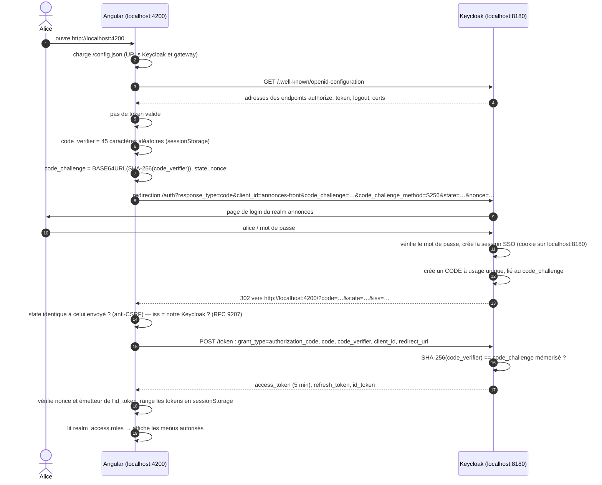
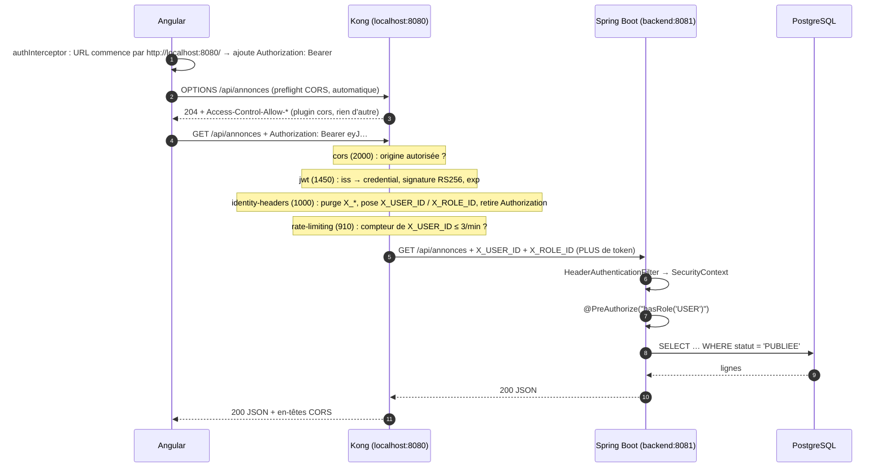
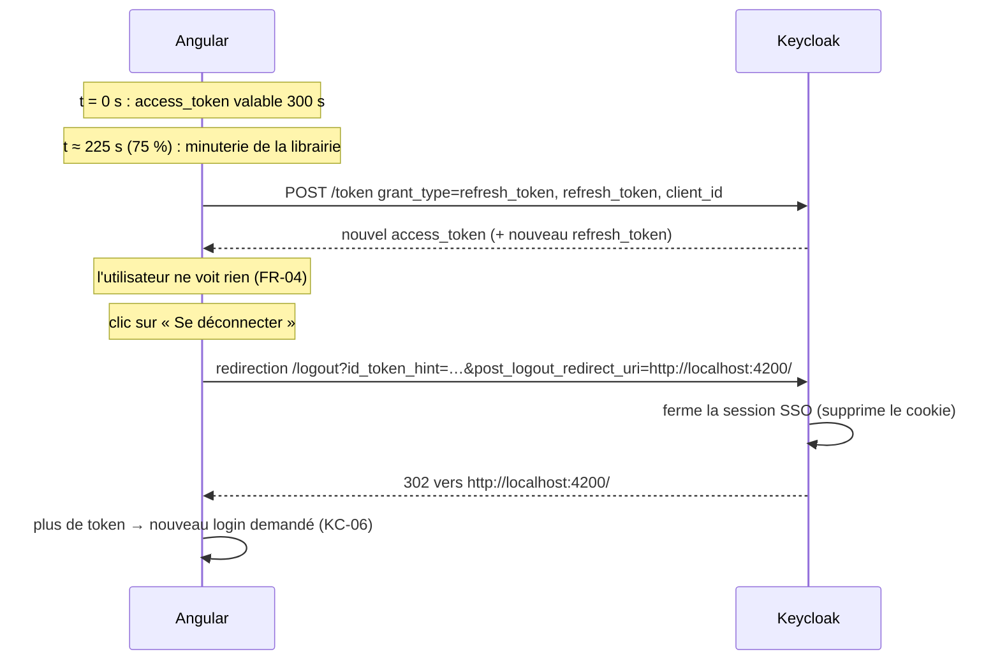

# 02 — Le flux d'authentification, de bout en bout

> Objectif : comprendre **qui fait quoi** quand alice se connecte puis appelle l'API, et **pourquoi**
> l'architecture est découpée ainsi. Les diagrammes Mermaid s'affichent directement sur GitHub.

---

## 1. Les acteurs et ce que chacun sait

| Acteur | Où | Ce qu'il détient | Ce qu'il fait |
|---|---|---|---|
| **Navigateur + Angular** | poste de l'utilisateur | les tokens (sessionStorage), le `code_verifier` le temps du login | lance le login, ajoute le Bearer aux appels API |
| **Keycloak** | `localhost:8180` | les comptes, les mots de passe (hashés), les rôles, la **clé PRIVÉE** RSA | **authentifie** et **signe** les tokens |
| **Kong** | `localhost:8080` | la **clé PUBLIQUE** RSA, la config `kong.yml` | **contrôle** : CORS, vérifie la signature, quota, traduit le token en headers |
| **Spring Boot** | `backend:8081` (réseau interne) | rien de cryptographique | **autorise** : règles `@PreAuthorize` à partir des headers |
| **PostgreSQL** | `postgres:5432` (réseau interne) | les données | — |

La séparation clé privée / clé publique est le cœur du système : **seul Keycloak peut fabriquer
un token**, mais **n'importe qui possédant la clé publique peut vérifier** qu'un token vient bien de lui.

---

## 2. D'où viennent les rôles

Tout est déclaré dans `keycloak/realm-annonces.json`, importé au premier démarrage.

```
Rôles de realm (composites)          Utilisateurs                 Rôles EFFECTIFS dans le token
┌──────────────────────────┐
│ ADMIN                    │ ◄────── admin  ─────────────────────► ADMIN, MODERATEUR, USER
│   └─ contient MODERATEUR │
│        └─ contient USER  │ ◄────── modo   ─────────────────────► MODERATEUR, USER
│ USER                     │ ◄────── alice, bob ─────────────────► USER
└──────────────────────────┘
```

1. **Création** : 3 rôles de realm. `MODERATEUR` est *composite* de `USER`, `ADMIN` de `MODERATEUR`.
2. **Attribution** : chaque utilisateur reçoit **un seul** rôle (`"realmRoles": ["MODERATEUR"]`).
3. **Expansion** : à l'émission du token, Keycloak **développe** les composites : modo reçoit
   `MODERATEUR` **et** `USER`.
4. **Filtre du client** : `annonces-front` n'a pas le *full scope* ; ses `scopeMappings` limitent
   les rôles copiés dans le token à `USER`, `MODERATEUR`, `ADMIN` (pas de rôles internes de Keycloak).
5. **Transport** : les rôles voyagent dans le claim `realm_access.roles` de l'**access token**.
6. **Usage** :
   - Angular les lit pour **afficher ou masquer** les menus (confort uniquement) ;
   - Kong les copie dans `X_ROLE_ID` ;
   - Spring les transforme en autorités `ROLE_USER`, `ROLE_MODERATEUR`… pour `hasRole(...)`.

---

## 3. Anatomie du JWT (access token d'alice)

Un JWT, ce sont trois blocs encodés en base64url, séparés par des points :

```
eyJhbGciOiJSUzI1NiIs...  .  eyJleHAiOjE3OTI0MTI2MzEs...  .  kX9f2Qm...(256 octets)
└──────── header ──────┘    └──────────── payload ─────┘    └──── signature ────┘
```

**Header** (décodé) : `{"alg":"RS256","typ":"JWT","kid":"iHTMFNnJ..."}`

**Payload** (décodé, raccourci) :
```json
{
  "iss": "http://localhost:8180/realms/annonces",   ← qui l'a émis (Kong cherche cette valeur)
  "sub": "501cbf20-5503-4aba-b756-6bb32583b075",    ← identifiant stable d'alice → X_USER_ID
  "azp": "annonces-front",                          ← client qui l'a demandé (vérifié par le plugin)
  "exp": 1792412631,  "iat": 1792412331,            ← expire 300 s après émission
  "preferred_username": "alice",
  "realm_access": { "roles": ["USER"] }            ← → X_ROLE_ID
}
```

**Signature** = `RSA_signer( SHA-256(header + "." + payload), clé PRIVÉE de Keycloak )`.

- Le payload n'est **pas chiffré** : n'importe qui peut le lire (`scripts/decode-jwt.sh`).
- Il est **infalsifiable** : modifier un seul caractère du payload rend la signature fausse, et
  sans la clé privée impossible d'en recalculer une valide.

---

## 4. Flux 1 — La connexion (Authorization Code + PKCE)



**Pourquoi tant d'étapes ?**

| Mécanisme | Il empêche… |
|---|---|
| `code` au lieu du token dans l'URL | qu'un token se retrouve dans l'historique, les logs, le Referer |
| **PKCE** (`code_challenge` / `code_verifier`) | qu'un code intercepté soit échangé par un tiers : sans le verifier, resté dans le navigateur, le code ne vaut rien |
| `state` | qu'un attaquant injecte SA réponse de login dans ta session (CSRF) |
| `nonce` | le rejeu d'un ancien id_token |
| `iss` dans la réponse | qu'un autre serveur d'autorisation se fasse passer pour le nôtre |
| client **public**, sans secret | rien à voler : une SPA ne peut de toute façon pas garder de secret |
| `password` et `implicit` désactivés | que l'appli manipule le mot de passe, ou reçoive le token dans l'URL |

---

## 5. Flux 2 — Un appel d'API, couche par couche

### 5.1 Vue d'ensemble



### 5.2 Côté Angular : comment le Bearer est ajouté

`frontend/src/app/core/auth/auth.interceptor.ts` intercepte **chaque** requête `HttpClient` :

```
requête HttpClient ──► l'URL commence-t-elle par "http://localhost:8080/" ?
                         ├─ oui → clone + en-tête  Authorization: Bearer <access_token>
                         └─ non → inchangée  (Keycloak, autres sites : le token ne fuit jamais)
```

Le token est lu dans sessionStorage via `OAuthService.getAccessToken()`.

### 5.3 Le preflight CORS

Le front (`:4200`) et l'API (`:8080`) sont deux **origines** différentes, et la requête porte un
en-tête `Authorization` : le navigateur demande d'abord la permission (`OPTIONS`). Le plugin
`cors`, priorité la plus haute, répond seul : **ni authentification, ni décompte du quota**.
Une origine non listée (`http://evil.local`) ne reçoit aucun `Access-Control-Allow-Origin` : le
navigateur bloque la lecture de la réponse.

### 5.4 Dans Kong : les 4 plugins, dans l'ordre

Kong exécute les plugins par **priorité décroissante**.

```
                         requête : GET /api/annonces
                         Authorization: Bearer eyJ…   (+ éventuels X_USER_ID forgés)
                                        │
 ┌──────────────────────────────────────▼───────────────────────────────────────┐
 │ 1. cors (2000)          origine autorisée ? preflight → réponse immédiate    │
 ├──────────────────────────────────────────────────────────────────────────────┤
 │ 2. jwt (1450)           a. extrait le token de l'en-tête Authorization       │
 │                         b. décode header + payload (base64url → JSON)        │
 │                         c. lit iss = "http://localhost:8180/realms/annonces" │
 │                         d. cherche le credential dont key == iss  ──► absent → 401
 │                         e. vérifie la signature RS256 avec la clé publique   │
 │                            du credential                       ──► fausse → 401
 │                         f. vérifie exp > maintenant            ──► expiré → 401
 │                         g. range le token validé dans kong.ctx.shared        │
 ├──────────────────────────────────────────────────────────────────────────────┤
 │ 3. identity-headers     a. SUPPRIME X_USER_ID, X_ROLE_ID, X-User-Id,         │
 │    (1000, plugin Lua)      X-Role-Id venus du client (anti-usurpation)       │
 │                         b. relit le token validé (pas de 2e vérification)    │
 │                         c. azp == "annonces-front" ?           ──► sinon 401 │
 │                         d. X_USER_ID = sub                                   │
 │                         e. X_ROLE_ID = realm_access.roles filtrés, triés     │
 │                         f. SUPPRIME Authorization                            │
 ├──────────────────────────────────────────────────────────────────────────────┤
 │ 4. rate-limiting (910)  compteur["minute", X_USER_ID] + 1 > 3 ?              │
 │                                                ──► 429 + Retry-After         │
 └──────────────────────────────────────┬───────────────────────────────────────┘
                                        │  vers http://backend:8081 (réseau internal)
                                        ▼
                         GET /api/annonces
                         X_USER_ID: 501cbf20-…   X_ROLE_ID: USER
                         (aucun Authorization, aucun token)
```

**Pourquoi cet ordre est obligatoire :**
- `jwt` avant `identity-headers` : on ne lit que des tokens dont la signature est prouvée ;
- `identity-headers` avant `rate-limiting` : le quota compte le **vrai** utilisateur (le `sub`
  du token), jamais une valeur envoyée par le client ;
- un 401 de `jwt` arrête tout : ni le quota ni le backend ne sont touchés.

**Deux pièges découverts en lisant le code source de Kong 3.9.4 :**
- Kong active `underscores_in_headers on` : un `X_USER_ID` forgé par le client **arrive** bien
  jusqu'à Kong. Sans la purge du plugin, il atteindrait le backend.
- nginx expose `X_USER_ID` **et** `X-User-Id` sous la même variable, que lit le rate limiting.
  Sans purger aussi la variante à tirets, on pourrait changer la clé de son compteur à chaque appel.

### 5.5 Côté Spring : « comment le JWT est décodé dans le back »

**Il ne l'est pas.** C'est un choix d'architecture : le backend n'a aucune dépendance JWT ou OAuth2
(critère BK-01) et ne reçoit **jamais** le token. Il reçoit deux en-têtes, posés par Kong :

```
HeaderAuthenticationFilter (OncePerRequestFilter)
   X_USER_ID = "501cbf20-…"     X_ROLE_ID = "MODERATEUR,USER"
        │
        ▼
   Authentication
     principal   = "501cbf20-…"
     authorities = [ROLE_MODERATEUR, ROLE_USER]
        │
        ▼
   SecurityContextHolder.setContext(...)      (vidé dans un finally en fin de requête)
        │
        ▼
   authorizeHttpRequests : anyRequest().authenticated()
        │      └─ pas de X_USER_ID → contexte vide → AuthenticationEntryPoint → 401 ProblemDetail
        ▼
   @PreAuthorize sur la méthode du contrôleur
        │      ex. hasRole('MODERATEUR') or @annonceSecurity.estAuteur(#id, authentication)
        │      └─ refus → AccessDeniedHandler → 403 ProblemDetail
        ▼
   Service métier → Repository JPA → PostgreSQL
```

**Pourquoi le backend peut-il faire confiance à des en-têtes ?** Parce qu'il n'est joignable **que**
sur le réseau Docker `internal`, et que le seul à pouvoir l'appeler est Kong, qui a purgé puis
reconstruit ces en-têtes à partir d'un token vérifié. Aucun port du backend n'est publié sur
l'hôte.

### 5.6 Qui répond quoi en cas d'erreur

| Code | Produit par | Cause | Le front… |
|---|---|---|---|
| 401 | Kong (`jwt`) | token absent, falsifié, expiré, autre émetteur | relance le login |
| 401 | Kong (`identity-headers`) | `azp` inattendu, `sub` absent | relance le login |
| 429 | Kong (`rate-limiting`) | 4ᵉ appel dans la minute | affiche « réessayez dans N s » (`Retry-After`) |
| 403 | Spring (`@PreAuthorize`) | rôle ou propriété insuffisants | affiche « Accès refusé », **sans** déconnecter |
| 404 | Spring | annonce inexistante **ou non visible** pour vous | « introuvable » |
| 400 / 409 | Spring | données invalides / conflit | erreurs de champs affichées sur le formulaire |

---

## 6. Flux 3 — Renouvellement et déconnexion



Le refresh token reste borné par la session SSO (30 min d'inactivité, 10 h maximum) : au-delà,
il faut se reconnecter.

---

## 7. Et s'il n'y avait pas de gateway ?

```
AVEC gateway (ce projet)                         SANS gateway
────────────────────────                         ────────────
Navigateur                                       Navigateur
   │ Bearer                                         │ Bearer
   ▼                                                ▼
 Kong ── vérifie JWT, CORS, quota          ┌── Service Annonces ── vérifie JWT, CORS, quota
   │   (une seule fois, au même endroit)   │     (spring-boot-starter-oauth2-resource-server,
   │ X_USER_ID / X_ROLE_ID                 │      télécharge le JWKS, configure issuer…)
   ▼                                       ├── Service Paiement ── refait la même chose
 Backend (réseau privé, sans JWT)          └── Service Messagerie ── et encore…
                                                 (chaque service est exposé sur Internet)
```

| | Avec gateway | Sans gateway |
|---|---|---|
| Vérification du token | **1 seul endroit** (Kong) | dans **chaque** service |
| Bibliothèques JWT/OAuth2 | aucune dans le backend | dans chaque service, à maintenir |
| CORS | 1 configuration | 1 par service, souvent incohérentes |
| Quota / anti-abus | centralisé, par utilisateur | à recoder partout, ou absent |
| Exposition réseau | seule la gateway est publique | tous les services publics |
| Changer d'IdP ou de clé | on modifie Kong | on modifie et redéploie tous les services |
| Point de défaillance | la gateway (à rendre redondante) | réparti |
| Défense en profondeur | le backend fait confiance au réseau | chaque service vérifie lui-même |

**Centraliser l'authentification**, c'est faire en sorte que la question « qui es-tu, et ton token
est-il valide ? » soit posée **une seule fois**, à l'entrée, par un composant spécialisé. Les
services derrière ne se posent plus que la question métier : « as-tu le droit de faire **ça** ? ».

Limite assumée : si un attaquant entrait sur le réseau interne, il pourrait forger les en-têtes.
Les parades classiques sont un secret partagé ou du **mTLS** entre Kong et le backend (bonus du sujet).

---

## 8. Récapitulatif en une phrase par couche

1. **Angular** obtient un token par le flux PKCE et l'ajoute en Bearer, uniquement vers la gateway.
2. **Keycloak** prouve l'identité et signe un token qui contient `sub` et les rôles.
3. **Kong** vérifie la signature avec la clé publique, remplace le token par deux en-têtes
   d'identité, compte les appels, et ne laisse passer que le trafic légitime.
4. **Spring Security** reconstruit l'utilisateur depuis ces en-têtes et applique les
   `@PreAuthorize` : c'est la **seule** couche qui décide des droits.
5. **Le front** masque des menus par confort, mais ne protège rien : le serveur reste seul juge.
