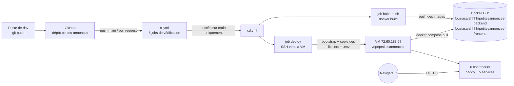
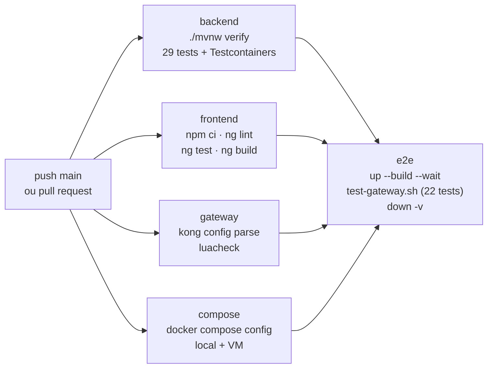
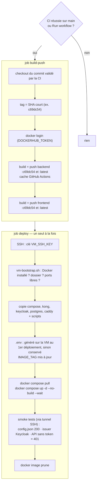

# 03 — De `git push` à la VM : images, Compose, CI/CD

> Ce document explique **comment le code devient une application qui tourne**, en local puis sur
> la VM. Procédure pas à pas de mise en service : [`deploiement.md`](deploiement.md).

---

## 1. Vue d'ensemble



Trois idées à retenir :
1. **La CI vérifie, la CD livre.** Une pull request ne déclenche que la CI ; seul un push sur `main`
   dont la CI est verte déclenche la CD.
2. **On ne construit qu'une fois.** Les images sont construites par GitHub Actions, publiées sur
   Docker Hub, puis simplement **téléchargées** par la VM (`--no-build`) : la VM ne compile rien et
   ne reçoit pas le code source.
3. **Une image, plusieurs environnements.** Les URLs et les secrets ne sont pas dans les images ;
   ils arrivent au démarrage par le fichier `.env`.

---

## 2. Les images Docker

### 2.1 Construites par nous (Dockerfile multi-stage)

```
backend/Dockerfile                                frontend/Dockerfile
──────────────────                                ───────────────────
┌ étape « build » ─────────────────────┐          ┌ étape « build » ─────────────────────┐
│ maven:3.9-eclipse-temurin-21-alpine  │          │ node:24-alpine                       │
│  COPY pom.xml → dependency:go-offline│          │  COPY package*.json → npm ci         │
│  COPY src     → mvn package          │          │  COPY .            → ng build prod   │
│  extraction des couches Spring Boot  │          └───────────────┬──────────────────────┘
└───────────────┬──────────────────────┘                          │ dist/frontend/browser
                │ dependencies/ loader/ application/              ▼
                ▼                                 ┌ étape « runtime » ───────────────────┐
┌ étape « runtime » ───────────────────┐          │ nginxinc/nginx-unprivileged          │
│ eclipse-temurin:21-jre-alpine        │          │  fichiers statiques                  │
│  utilisateur « app » (non-root)      │          │  30-config-json.sh → /config.json    │
│  une couche Docker par couche Boot   │          │  au démarrage, CSP, non-root, :8080  │
│  java … JarLauncher        :8081     │          └──────────────────────────────────────┘
└──────────────────────────────────────┘
```

**Pourquoi multi-stage ?** L'image finale ne contient ni Maven, ni Node, ni le code source :
seulement de quoi exécuter. Elle est plus petite (téléchargement rapide sur la VM) et offre moins
de surface d'attaque. **Pourquoi copier `pom.xml` / `package.json` avant le code ?** Docker met
chaque instruction en cache : tant que les dépendances ne changent pas, elles ne sont pas
retéléchargées.

### 2.2 Images officielles, utilisées telles quelles

| Image | Rôle | Configuration apportée par… |
|---|---|---|
| `postgres:16.15-alpine` | base de données | `postgres/init.sql` monté en volume |
| `quay.io/keycloak/keycloak:26.8.1` | fournisseur d'identité | `keycloak/realm-annonces.json` monté |
| `kong:3.9.4` | gateway | `kong/kong.yml` + `kong/plugins/` montés |
| `caddy:2.11.7-alpine` | HTTPS (VM uniquement) | `caddy/Caddyfile` monté |

C'est pour cela que la CD copie ces dossiers sur la VM : ils sont montés dans les conteneurs.

---

## 3. Docker Compose : services, réseaux, volumes

```
                         ┌──────────────── réseau « public » ────────────────┐
  hôte 127.0.0.1:4200 ──►│ frontend                                          │
  hôte 127.0.0.1:8180 ──►│ keycloak ──────────┐                              │
  hôte 127.0.0.1:8080 ──►│ gateway ───────────┼──┐                           │
  (VM) :80 / :443 ──────►│ caddy (VM seulement)│  │                           │
                         └─────────────────────┼──┼───────────────────────────┘
                         ┌──────────── réseau « internal » (internal: true) ─┐
                         │                     │  └──► backend :8081         │
                         │                     └─────► postgres :5432 ◄──────│── backend
                         └───────────────────────────────────────────────────┘
  volumes nommés :  postgres-data  →  /var/lib/postgresql/data   (comptes Keycloak + annonces)
                    caddy-data, caddy-config  (certificats Let's Encrypt, VM seulement)
```

| Élément | Rôle |
|---|---|
| **Réseau `internal`** (`internal: true`) | aucune route vers l'extérieur ; `backend` et `postgres` n'existent que là → injoignables depuis l'hôte |
| **Ports sur `127.0.0.1`** | joignables depuis la machine elle-même uniquement (Docker contourne le pare-feu ufw) |
| **Volume `postgres-data`** | survit à `docker compose down` ; seul `down -v` l'efface (DEP-04) |
| **Healthchecks + `depends_on: service_healthy`** | ordre de démarrage garanti : postgres → keycloak et backend → gateway → frontend (→ caddy) |
| **`build:` + `image:`** | en local `up --build` construit ; sur la VM `pull` + `up --no-build` télécharge |

Ordre de démarrage :
```
postgres ──healthy──► keycloak ─────────────────────healthy──┐
    └─────healthy──► backend ──healthy──► gateway ──healthy──┴──► frontend ──► (caddy sur la VM)
```

### Local ou VM : ce qui change

| | Local | VM |
|---|---|---|
| Fichiers Compose | `docker-compose.yml` | `docker-compose.yml` **+** `docker-compose.vm.yml` (ajoute Caddy) |
| Variables | `.env` copié de `.env.example` (valeurs de dev publiques) | `.env` **généré sur la VM** au 1er déploiement, conservé ensuite |
| URLs | `http://localhost:4200 / 8080 / 8180` | `https://app. / api. / auth.72-60-188-97.sslip.io` |
| Images backend/frontend | construites sur place (`--build`) | téléchargées de Docker Hub (`pull`, `--no-build`) |
| Clé RSA du realm | clé de dev de `.env.example` | nouvelle clé générée sur la VM |

---

## 4. `ci.yml` — l'intégration continue

**Déclencheurs** : `push` sur `main` et toute `pull_request`.
Un nouveau push annule l'exécution en cours sur la même branche (`concurrency`).



| Job | Ce qu'il prouve | Durée indicative |
|---|---|---|
| backend | règles de sécurité et métier (BK, MT) sur un vrai PostgreSQL | ~2 min |
| frontend | code propre, intercepteurs/guard testés, build de prod OK | ~1 min |
| gateway | `kong.yml` accepté par Kong lui-même, plugin Lua sans erreur | ~30 s |
| compose | fichiers Compose syntaxiquement valides | ~10 s |
| e2e | **toute la chaîne** : tokens PKCE réels, JWT forgés, quota | ~5 min |

Les quatre premiers tournent **en parallèle** ; `e2e` (le plus coûteux) n'est lancé que s'ils
réussissent tous. Le job e2e n'utilise que les valeurs de **dev** de `.env.example` : aucun secret
n'est nécessaire, une pull request venant d'un fork peut donc être testée sans risque.

---

## 5. `cd.yml` — le déploiement continu

**Déclencheurs** :
- `workflow_run` : quand **CI** se termine sur `main` → on ne déploie que si elle a **réussi** ;
- `workflow_dispatch` : bouton *Run workflow*, avec un `image_tag` optionnel (rollback).



### Les secrets et où ils servent

| Secret | Utilisé par | Pour |
|---|---|---|
| `DOCKERHUB_USERNAME`, `DOCKERHUB_TOKEN` | build-push | se connecter à Docker Hub et pousser les images |
| `VM_HOST`, `VM_USER`, `VM_SSH_PORT`, `VM_SSH_KEY` | deploy | ouvrir la session SSH |

GitHub masque automatiquement ces valeurs dans les logs, et elles ne sont jamais écrites dans le dépôt.

Les **mots de passe de l'application** ne font pas partie de ces secrets : au premier déploiement,
`scripts/init-prod-env.sh` les génère **sur la VM** (`/opt/petitesannonces/.env`, droits 600). Ils ne
quittent donc jamais le serveur ; les déploiements suivants réutilisent ce fichier.

### Les tags d'images et le rollback

Chaque image reçoit deux tags :
- le **SHA court** du commit (`c69dc54`) : immuable, il désigne exactement ce code ;
- **`latest`** : le dernier déploiement.

Le `.env` de la VM reçoit `IMAGE_TAG=<sha>` : Compose tire précisément cette version. Pour
revenir en arrière : *Run workflow* avec `image_tag` = un SHA précédent. Le build est sauté et
la VM redémarre sur les anciennes images.

---

## 6. Le parcours complet d'une modification

```
1. tu modifies le code, tu crées une branche et une pull request
      └─► CI (5 jobs) ── rouge ? → tu corriges, rien n'est déployé
2. la CI est verte → tu merges dans main
      └─► CI repart sur main
3. CI verte sur main → CD
      ├─ build-push : images :<sha> et :latest sur Docker Hub
      └─ deploy     : VM prête → fichiers + .env → pull → up → smoke tests
4. l'application est à jour sur https://app.72-60-188-97.sslip.io
```

---

## 7. Ce qui ne passe PAS par la pipeline

- **La base de données** : le volume `postgres-data` sur la VM n'est jamais recréé par un
  déploiement. Les annonces et les comptes Keycloak survivent aux mises à jour.
- **Le realm et `init.sql`** ne s'appliquent qu'au **premier** démarrage. Une modification
  ultérieure du realm demande soit une action dans la console Keycloak, soit une remise à zéro
  du volume (avec perte des données).
- **Les certificats HTTPS** sont gérés par Caddy et conservés dans le volume `caddy-data`.
